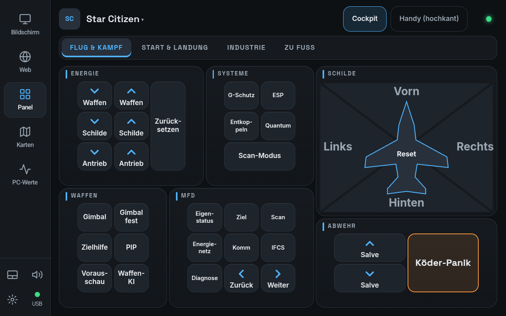

# Tablet Deck

Lenovo Tab M10 HD (TB-X505F) als USB-Erweiterung für den Windows-PC: Bedienpanel (Star Citizen u. a.),
Touchpad, Medien und Lautstärke, Zweitbildschirm (spacedesk).
Tablet-Einrichtung: [docs/tablet-setup.md](docs/tablet-setup.md).

**Bedienung mit Bildern: [docs/guide.md](docs/guide.md)**

Änderungen je Version: [CHANGELOG.md](CHANGELOG.md)



```
Tablet: LineageOS-GSI + Magisk ── Launcher-App "Tablet Deck" (Startbildschirm)
          │  WebViews: Panel /, Touchpad + Medien /touchpad/  ·  Steuerseite /ctl.html
          │  USB-Kabel: adb reverse tcp:8765 → PC (kein WLAN nötig)
PC:     Hub (python -m bridge)  ── SendInput: Tasten, Maus, Text, Medientasten · Lautstärke (pycaw)
                                ── Taskleisten-Symbol · Automatik nach laufenden Programmen
```

## Installation
`powershell -ExecutionPolicy Bypass -File .\install.ps1` richtet PC und (angestecktes) Tablet ein:
Python (falls es fehlt), Python-Pakete, adb, spacedesk-Treiber, Autostart, Launcher. Die Launcher-App
(`tablet-deck.apk`) liegt in den [Releases](https://github.com/Naetschie/tablet-deck/releases); das Skript lädt
sie selbst, wenn sie fehlt, oder nimmt sie mit `-Apk <Pfad>`. Details und Fehlersuche:
[docs/install.md](docs/install.md).

## Start
`start.bat` (oder `python -m bridge`). Der Hub
- liefert die Tablet-Seiten aus und nimmt Eingaben per WebSocket an (`/ws`, Launcher-Steuerung `/ctl`),
- richtet für jedes angesteckte Tablet `adb reverse` ein, hält es wach, öffnet den Launcher und stellt
  die Uhrzeit des Tablets (beim Verbinden und stündlich),
- zeigt ein Taskleisten-Symbol (Modus am Tablet wählen, Seiten neu laden, beenden),
- wechselt den Tablet-Modus automatisch nach laufenden Programmen (`auto_modes`).

Sicherheit: Verbindung weg → alle gehaltenen Tasten und Maustasten werden losgelassen. Nur Seiten des
Hubs (Origin-Prüfung, CSP) dürfen Eingaben senden.

## Konfiguration
`config.json`:

| Feld | Bedeutung |
|---|---|
| `host` / `port` | `127.0.0.1:8765` = nur USB (WLAN kommt später mit Kopplung) |
| `output` | `keyboard` (Panel-Tasten per SendInput) |
| `tablet_autostart` | beim Anstecken den Launcher in den Vordergrund holen |
| `tablet_mode` | `home` (Standard: Launcher ist der Startbildschirm, Root) oder `companion` (normale App ohne Root, `install.ps1 -Companion`; siehe [docs/install.md](docs/install.md#begleit-modus-ohne-root)) |
| `tablet_timezone` | Zeitzone für das Tablet (z. B. `Europe/Berlin`) |
| `tray` | Taskleisten-Symbol an/aus |
| `auto_modes` / `auto_default` | z. B. `[{"process": "StarCitizen.exe", "mode": "panel"}]` |
| `tablet_rotation`, `spacedesk_usb`, `spacedesk_silence`, `audio_output`, `web`, `web_proxy_port`, `tablet_sleep_with_pc` | siehe [docs/install.md](docs/install.md#einstellungen-configjson) |

`launcher.json`: Kacheln des Launchers. `web` mit `path` (optional `port` für einen anderen Dienst am PC,
z. B. ein Dashboard; die Bridge leitet ihn per adb weiter), `app` mit Paketname, `browser` für
fremde Webseiten. `"start": true` wählt die Kachel beim Start.
Änderungen werden live übernommen.

`games.json`: Spiele mit Programmnamen (`exe`, für die Erkennung), Steam-AppID, Reihenfolge der Panels
und Kartenanbietern. Läuft ein Spiel, zeigt das Panel dessen erstes Panel (Wechsel per Reiter bleibt bis
zum nächsten Spielwechsel); `"game_panel": false` in config.json schaltet den Kachelwechsel ab.
Installierte Spiele ohne Eintrag (Steam, Epic, GOG usw.) schlägt der Hub im Hintergrund bei Map Genie nach und
bietet deren Karten direkt in der Karten-Kachel an (Ergebnis 30 Tage in `mapgenie_cache.json`).

`profiles/<spiel>/<panel>.json`: ein Panel (Titel, Seiten, Tasten), live neu geladen. `key` =
Tastenkombination (z. B. `"LALT+F"`), `mode: "hold-confirm"` löst erst nach `holdMs` Halten aus. Tasten
ohne Belegung sind gestrichelt. Ein altes `layout.json` (frühe Versionen) wird beim ersten Start als
`profiles/star-citizen/main.json` übernommen; sonst ist für Star Citizen das mitgelieferte Panel **Cockpit**
der Standard (siehe `docs/star-citizen.md`).

`panels/<spiel>/<name>.json`: **mitgelieferte** Panels (im Git und im Zip, schreibgeschützt). Sie erscheinen
im Editor und am Tablet mit Schloss neben den eigenen (`profiles/`), nichts wird verdeckt; intern heißen sie
`<spiel>/std--<name>`. Bearbeiten geht nur über „Kopie bearbeiten“ (landet als `<name>-eigen` in `profiles/`),
Updates ändern daher nie etwas Eigenes. Hat ein Spiel eigene Panels, bleibt das erste eigene das Standard-Panel;
ein mitgeliefertes ist nur der Rückfall. Tasten mit `sc` bekommen beim Laden die echte Star-Citizen-Belegung.

## Touchpad-Seite: Lautstärke und Mixer
Unter dem Master-Regler zeigt die Karte „Mixer“ je App einen Regler mit Stumm-Knopf (Apps mit mehreren
Audio-Sitzungen erscheinen einmal, Systemklänge als „Systemklänge“) und darunter die Wiedergabegeräte; ein Tipp
stellt die Standard-Ausgabe um. Nachrichten (`/ws`, Details in `bridge/pcinput.py`):
- Tablet → PC: `{"t":"app_volume","k":"1234","v":0.4}`, `{"t":"app_mute","k":"1234","on":true}`,
  `{"t":"output","id":"…"}` (`k` = PID als Text oder `"sys"`; nur Geräte-IDs aus der aktuellen Liste gelten)
- PC → Tablet: `{"t":"mixer","sessions":[{"k","name","v","mute"}],"devices":[{"id","name"}],"default":"id"}`,
  etwa jede Sekunde, nur bei Änderung; beim Verbinden gleich nach `hello`. Läuft ein Spiel, trägt dessen
  Prozess den Spielnamen, sonst gilt die Programmbeschreibung der exe.

## Tablet-Teil
- Launcher bauen und einrichten: `python android/build.py`, dann `tablet\setup-launcher.ps1`
- Magisk-Module: `tablet\install-module.ps1 tablet\<modul>\module -Reboot`
  - `chargectl`: Akku zwischen 45 und 55 % halten
  - `hardening`: Fabrik-Testdienste aus, Firewall gegen eingehende Verbindungen
  - `selinux-fix`: vorbereitete SELinux-Regeln (Tablet läuft noch permissive, siehe docs/tablet-setup.md)
- Werkzeuge (JDK, Android-SDK, platform-tools, Firmware) liegen in `tools/` und sind nicht im Git.

## Tests
`python tests/smoke_bridge.py` gegen einen laufenden Hub. Er sendet nur Tasten ohne Belegung.

## Lizenz
GNU General Public License v3.0, siehe `LICENSE`. Fremde Bestandteile (Icons, Schriften, Abhängigkeiten): `THIRD_PARTY.md`.
