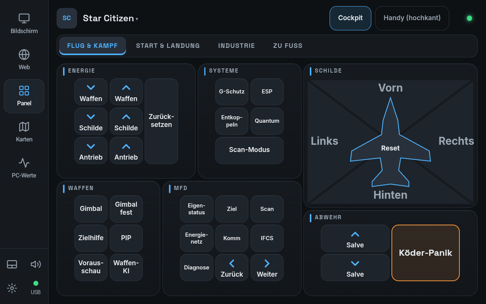
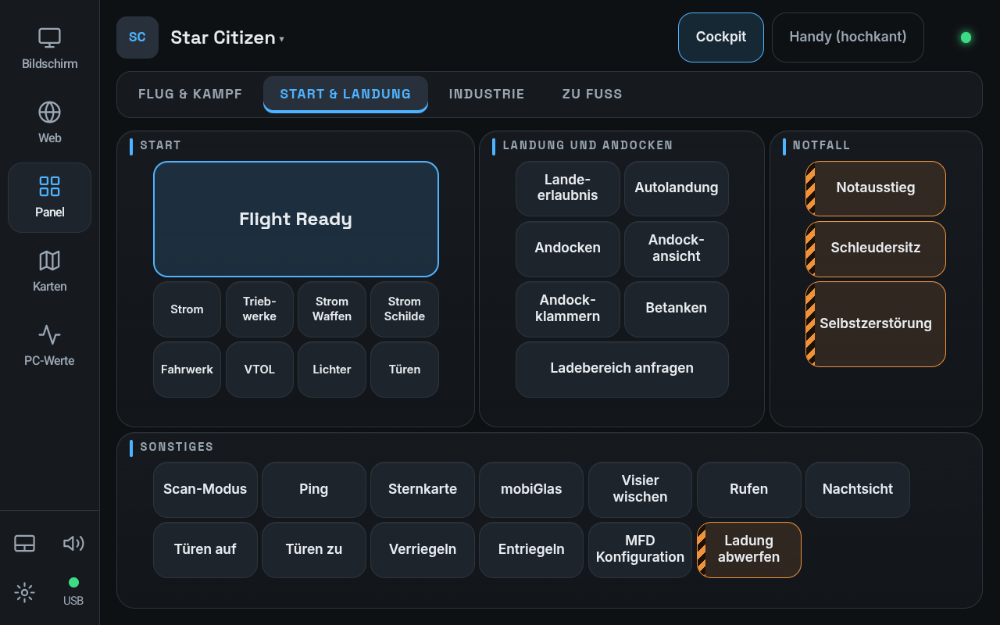
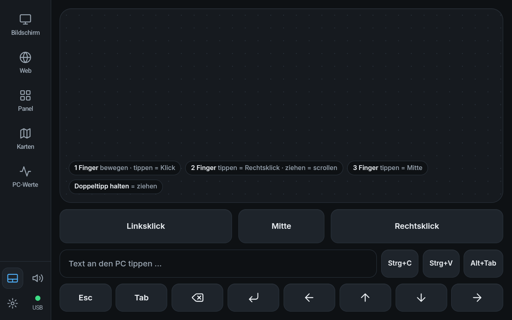
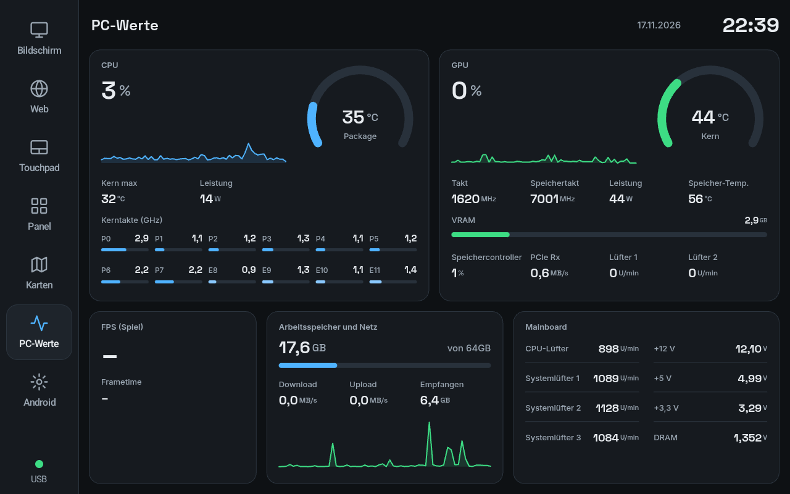
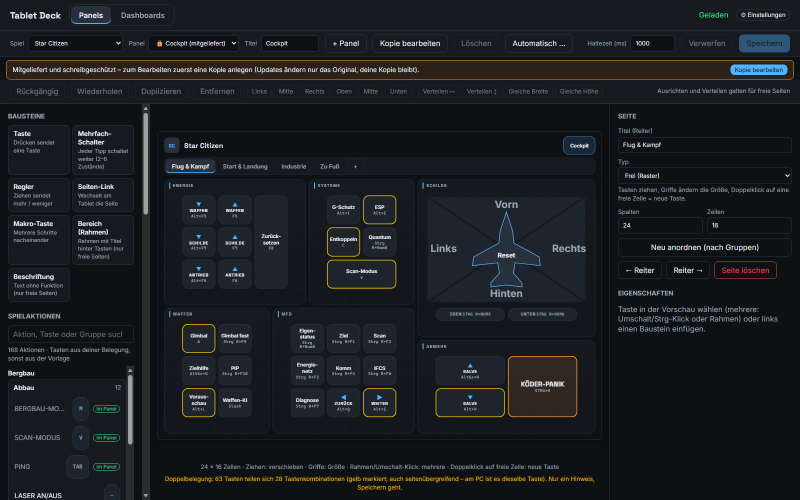
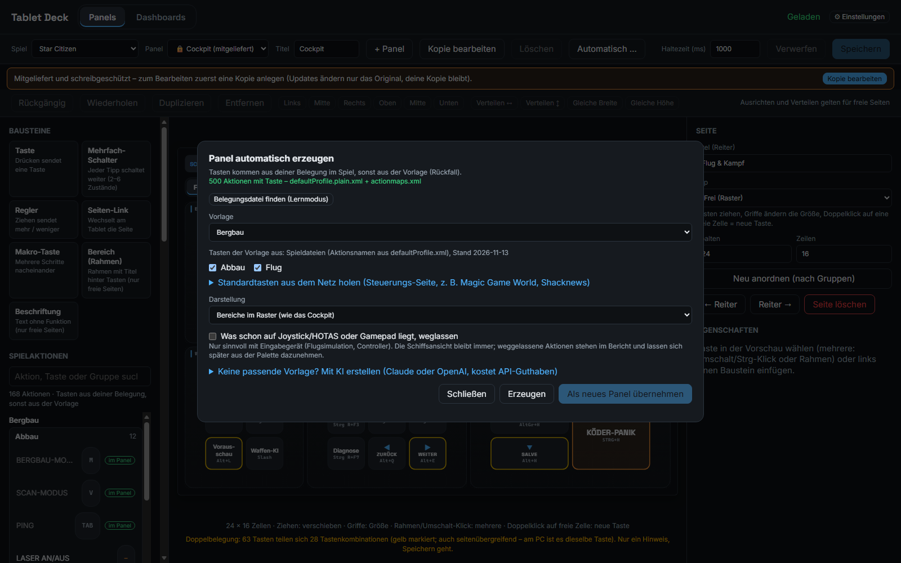

# Guide: Tablet Deck benutzen

Tablet Deck macht aus einem Android-Tablet eine Erweiterung für den Windows-PC: Spiel-Panels mit großen
Tasten, Touchpad mit Medien und Lautstärke, PC-Messwerte, Karten und Webseiten. Dieser Guide zeigt den
Alltag; Einrichtung und Fehlersuche stehen in [install.md](install.md).

## Inhalt
1. [Die Leiste am Tablet](#1-die-leiste-am-tablet)
2. [Spiel-Panels](#2-spiel-panels)
3. [Touchpad, Medien und Lautstärke](#3-touchpad-medien-und-lautstärke)
4. [PC-Werte](#4-pc-werte)
5. [Panels bearbeiten (Editor)](#5-panels-bearbeiten-editor)
6. [Panel automatisch erzeugen](#6-panel-automatisch-erzeugen)
7. [KI (optional)](#7-ki-optional)
8. [Eigene Panels teilen](#8-eigene-panels-teilen)
9. [Karten](#9-karten)

---

## 1. Die Leiste am Tablet
Links am Tablet sitzt die Leiste mit den Kacheln (einstellbar in `launcher.json`, beim ersten Start aus `launcher.example.json` angelegt):

| Kachel | Wozu |
|---|---|
| **Bildschirm** | Tablet als Zweitbildschirm (spacedesk per USB) |
| **Web** | Webseiten im Tablet-Browser; Seiten lassen sich vom PC ans Tablet schicken |
| **Touchpad** | Maus, Tastatur-Kürzel, Medien, Lautstärke und Mixer |
| **Panel** | Spiel-Panel des laufenden Spiels |
| **Karten** | Spielkarten (Map Genie zuerst, wo vorhanden), siehe [Karten](#9-karten) |
| **PC-Werte** | CPU, GPU, Speicher, Lüfter, FPS |
| **Android** | Android-Einstellungen |

Der Punkt unten zeigt die Verbindung (**USB** oder **WLAN**). Läuft ein bekanntes Spiel, wechselt das
Tablet von selbst auf dessen Panel (Spiele und Programmnamen in `games.json`).

## 2. Spiel-Panels

- Oben stehen das Spiel (Tipp auf den Namen = anderes Spiel, wenn mehrere Panels haben), daneben die Panels
  des Spiels (falls es mehrere gibt) und darunter die Seiten als Reiter.
- Jede Taste zeigt ihre Funktion. Ein Tipp schickt die **echte Taste** aus deiner Belegung im Spiel an den PC;
  das Spiel merkt keinen Unterschied zur Tastatur. Die Tastenkombination steht im Editor; am Tablet erscheint sie
  unter den Tasten nur auf Wunsch: Panel-Kachel in `launcher.json` mit `"path": "/?keys=1"` (gemerkt, `?keys=0` aus).
- **Bereiche** (Energie, Systeme, Waffen …) fassen zusammengehörige Tasten zusammen.
- Pfeiltasten (▲ ▼ ◀ ▶) sind Paare für mehr/weniger oder vor/zurück.
- **Gestreifte Tasten** sind gesichert (z. B. Selbstzerstörung) und lösen erst nach Gedrückthalten oder
  Doppeltipp aus.
- **Schilde** im Star-Citizen-Panel: auf die Seite des Schiffs tippen, die mehr Schild bekommen soll,
  Mitte = gleichmäßig.
- Gestrichelte Tasten haben im Spiel keine Belegung; die fehlenden Tasten lassen sich dort nachtragen.

Manche Spiele werten eine Taste erst nach einer Mindest-Haltezeit (Star Citizen z. B. Autolandung); das
Panel hält sie dann von selbst lange genug. Mehr zur Star-Citizen-Belegung: [star-citizen.md](star-citizen.md).

## 3. Touchpad, Medien und Lautstärke

- **Fläche:** 1 Finger bewegt, Tipp = Klick; 2 Finger Tipp = Rechtsklick, ziehen = scrollen;
  3 Finger = Mittelklick; Doppeltipp halten = ziehen.
- **Textfeld:** tippt Text am PC ein; darunter häufige Kürzel und Pfeiltasten.
- **Wiedergabe:** Zurück / Abspielen / Weiter für den laufenden Player.
- **Lautstärke** des PCs, **Mixer** je Programm (mit Stumm-Knopf) und **Ausgabe**: Wiedergabegerät wählen.

## 4. PC-Werte

Live-Werte vom PC: Auslastung, Temperaturen, Takte, Leistung, Speicher, Netz, Lüfter und Spannungen,
im Spiel auch FPS. Für alle Sensoren braucht es den Sensor-Helfer mit Adminrechten
([install.md](install.md#sensor-helfer-pc-werte-mit-adminrechten)). Eigene Dashboards baut man im Editor
unter **Dashboards** ([sensors.md](sensors.md)).

## 5. Panels bearbeiten (Editor)
Der Editor läuft im Browser am PC: Taskleisten-Symbol des Hubs → **Panel-Editor öffnen**.

- **Oben:** Spiel und Panel wählen, neues Panel (**+ Panel**), Titel, Speichern.
- **Mitgelieferte Panels** (mit Schloss) sind schreibgeschützt: **Kopie bearbeiten** legt eine eigene Kopie
  an. Updates ändern nur das Original, deine Kopie bleibt.
- **Links, Bausteine:** Taste, Mehrfach-Schalter, Regler, Seiten-Link, Makro, Bereich, Beschriftung,
  per Klick einfügen.
- **Links, Spielaktionen:** alle Aktionen des Spiels mit ihrer Taste aus deiner Belegung, durchsuchbar;
  „im Panel“ zeigt, was schon drin ist.
- **Mitte, Vorschau:** Tasten ziehen, an den Griffen die Größe ändern, Doppelklick auf eine freie Zelle =
  neue Taste. Mehrere wählen mit Rahmen oder Umschalt-/Strg-Klick, dann ausrichten und verteilen.
- **Rechts:** Eigenschaften der gewählten Taste (Beschriftung, Aktion, Taste, Aussehen, Sicherung) oder der
  Seite (Reiter, Raster). **Neu anordnen** ordnet eine Seite nach ihren Bereichen.
- Gelb markierte Tasten teilen sich eine Tastenkombination. Das ist nur ein Hinweis, Speichern geht trotzdem.

Gespeichert wird in `profiles/<spiel>/<panel>.json`; das Tablet übernimmt Änderungen sofort.

## 6. Panel automatisch erzeugen
**Automatisch …** im Editor baut ein Panel aus einer Vorlage und deiner echten Tastenbelegung.

1. **Belegung:** Der Hub sucht die Steuerungsdatei des Spiels selbst (Spielordner, Dokumente, AppData,
   Steam-Cloud) und meldet, wie viele Aktionen er gelesen hat. Findet er nichts, hilft
   **Belegungsdatei finden (Lernmodus):** im Spiel eine Taste ändern, der Hub erkennt die geänderte Datei.
   Ist die Datei verschlüsselt, sagt der Hub das; dann gelten die Tasten der Vorlage.
2. **Vorlage:** eine Spielvorlage wählen (welche Bereiche und Aktionen) und Bereiche an-/abwählen. Jede
   Vorlage nennt ihre Quelle.
3. **Standardtasten aus dem Netz holen:** gibt es keine Vorlage, sucht der Hub eine Steuerungs-Seite
   (z. B. Magic Game World, All Things How) oder liest eine eingefügte Adresse und macht daraus eine Vorlage.
4. **Darstellung:** *Bereiche im Raster* (wie das Cockpit) oder *Kacheln* (einfach, nach Gruppen).
5. **Joystick/HOTAS/Gamepad weglassen** (optional): Aktionen, die schon auf einem Eingabegerät liegen,
   kommen nicht aufs Panel.
6. **Erzeugen** zeigt eine Vorschau mit Bericht, **Als neues Panel übernehmen** speichert sie.

Tasten werden nie geraten: Sie kommen aus deiner Belegung, sonst aus der genannten Quelle der Vorlage.

## 7. KI (optional)
Unter **⚙ Einstellungen** lässt sich ein API-Schlüssel hinterlegen, für **Anthropic (Claude)** oder
**OpenAI**. Er bleibt auf dem PC (`secrets/`), wird nie angezeigt und kostet je Nutzung etwas Guthaben
beim Anbieter.

- **Mit KI suchen** (bei „Standardtasten aus dem Netz“): Die KI sucht Steuerungs-Seiten im Netz. Jede
  gemeldete Taste prüft der Hub danach selbst auf der Seite nach, nur Bestätigtes kommt in die Vorlage.
- **Mit KI erstellen:** Die KI entwirft für Spiele ohne Vorlage die Seiten und Bereiche. Den änderbaren Teil
  der Anweisung kannst du anpassen, die Tasten kommen trotzdem aus deiner Belegung.

Ohne Schlüssel funktioniert alles andere genauso.

## 8. Eigene Panels teilen
Eigene Panels sind JSON-Dateien in `profiles/<spiel>/`. Wer eins beisteuern möchte: Regeln und Prüfung in
[CONTRIBUTING.md](../CONTRIBUTING.md) (`python scripts/check_contrib.py <datei>`).

## 9. Karten
Die Kachel **Karten** zeigt Ingame-Karten fremder Anbieter. Oben links wählst du Spiel und Karte, oben rechts
geht es zu Neu laden und Vollbild. Läuft ein Spiel, springt die Kachel auf dessen Karte.

- **Woher die Karten kommen:** mitgelieferte Spiele aus `games.json`; für alle anderen installierten Spiele
  (Steam, Epic, GOG …) sucht der Hub im Hintergrund bei Map Genie und bietet jede Karte direkt an.
- **Eigene Liste:** Im Editor unter **Karten** ein Spiel wählen, Karten hinzufügen, umbenennen, löschen und
  mit ↑/↓ sortieren (die erste wird zuerst gezeigt). **Bei Map Genie suchen** schlägt das Spiel neu nach,
  **Zeigen** öffnet eine gespeicherte Karte sofort am Tablet, **Standard** stellt die mitgelieferte bzw.
  gefundene Liste wieder her. Gespeichert wird in `maps.json` am PC; `games.json` bleibt unverändert und
  darf bei einem Update überschrieben werden.
- **Schwer:** markiert aufwendige 3D-Karten (z. B. die Ark Starmap). Geräte im Light-Modus wählen sie nicht
  von selbst.
- Werbung und Messdienste lädt die Karten-Kachel nicht.
